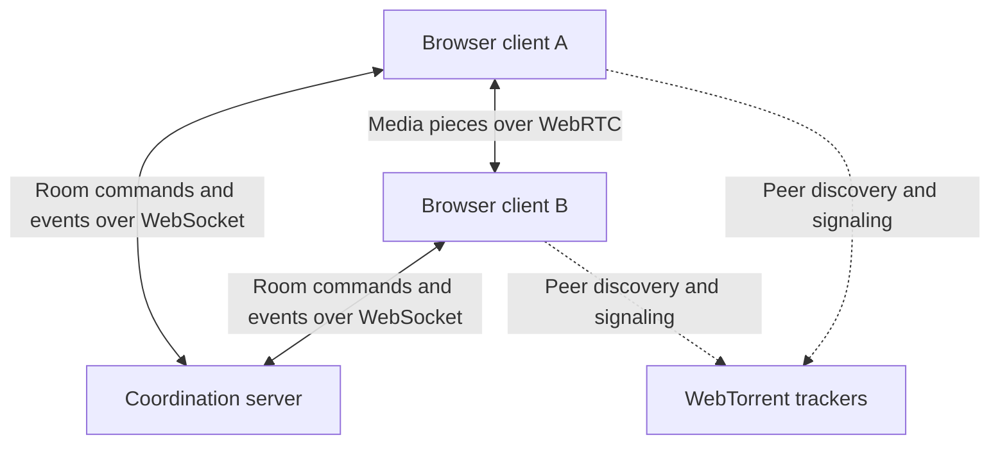
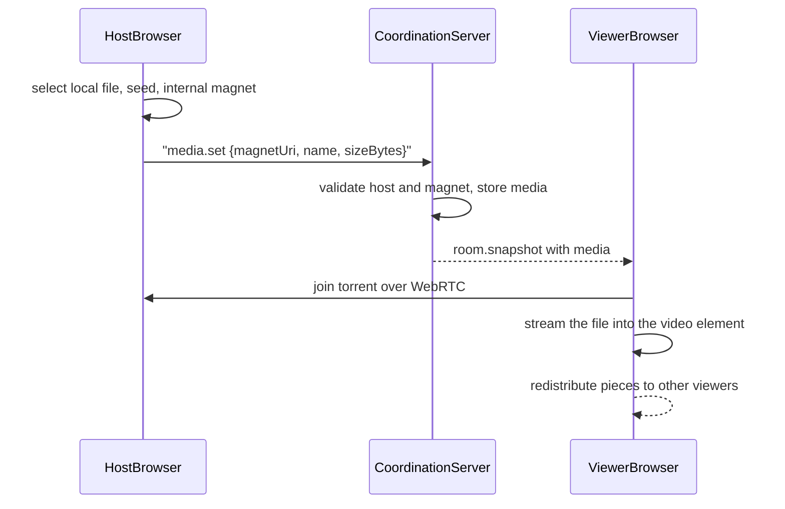

# SwarmCue Architecture

**Status:** Draft

## Purpose

SwarmCue is a browser-first, peer-to-peer watch-party application for small private rooms.

SwarmCue lets someone select a local video and watch it with friends. The file is progressively distributed directly between room participants while a coordination server keeps playback synchronized.

It is neither conventional server-side video streaming nor a general torrent application. It combines private peer-to-peer media distribution with synchronized watch-party coordination.

The system separates two main responsibilities:

1. **Media delivery:** WebTorrent and WebRTC deliver media directly between participants.
2. **Room coordination:** A central server manages participants, permissions, queue state, and synchronized playback.

The coordination server does not upload, store, transcode, or stream the video itself.

## V1 Architectural Constraints

- The application is browser-first and supports media formats the browser can play natively.
- V1 accepts local, browser-compatible video files chosen by an authorized participant (the host).
- SwarmCue internally creates one browser-compatible torrent per selected file.
- The generated magnet URI is distributed to participants through the coordination server as room state.
- Arbitrary user-provided magnet links are not supported in V1.
- WebTorrent and magnet URIs are implementation details, not user-facing concepts.
- Rooms are temporary and anonymous; users do not need accounts.
- A room is designed and tested for up to five participants.
- Shared room state is stored in the coordination server's memory.
- V1 runs a single coordination server instance.
- Restarting the server may destroy active rooms.
- Media is transferred between peers rather than through the coordination server.
- WebTorrent handles torrent protocol behavior; SwarmCue does not implement BitTorrent itself.
- V1 does not include built-in text or voice chat.

## System Overview



Each participant runs the SwarmCue web client in their browser.
The browser clients maintain WebSocket connections to the coordination server for shared room state. Media pieces travel directly between participating peers through WebTorrent rather than passing through the coordination server.
WebTorrent-compatible trackers help peers discover and establish connections with each other. They do not act as the source of the media.

## Media Sharing Flow

1. The host selects a local video.
2. The host's browser creates and seeds a WebTorrent torrent for that file.
3. SwarmCue generates a browser-compatible magnet URI for the torrent.
4. The client sends the magnet URI and media metadata (name, size) to the coordination server.
5. The server checks that the sender is allowed to change the media, stores it as the current media, and distributes it to room participants.
6. Other clients automatically join the generated torrent and progressively play the video.
7. Participants redistribute downloaded pieces among themselves when possible.

The video file itself never passes through the coordination server. The server only stores and forwards the magnet URI and metadata.



## Browser Client Responsibilities

The browser client is responsible for:

- Rendering the room interface and participant state.
- Creating and maintaining the WebSocket connection to the coordination server.
- Sending user intentions such as play, pause, seek, and pause requests.
- Receiving authoritative room updates and applying them locally.
- Controlling the local HTML video player.
- Comparing local playback with the expected room position.
- Correcting playback drift when necessary.
- Reporting local readiness, buffering, and connection status.
- Creating and seeding a torrent from the host's selected local file.
- Joining the shared torrent, streaming it progressively, and redistributing downloaded pieces.
- Connecting progressively downloaded media to the video player.
- Managing personal subtitles and displaying shared subtitles.

## Coordination Server Responsibilities

The coordination server is responsible for:

- Creating temporary rooms and generating room identifiers.
- Tracking connected participants and their room membership.
- Maintaining authoritative shared room state.
- Managing host and controller permissions.
- Validating whether participants are allowed to perform requested actions.
- Managing the media queue and currently selected media (the internal magnet URI and its metadata; never the file itself).
- Accepting playback commands such as play, pause, and seek.
- Updating and broadcasting authoritative playback state.
- Managing buffering reports and pause requests.
- Sending complete room snapshots to joining or reconnecting participants.
- Handling disconnections and host reconnection grace periods.
- Transferring host ownership when the previous host does not return.
- Managing shared subtitle metadata.
- Removing abandoned or expired rooms.
- Rejecting malformed, unauthorized, or excessive client messages.

The coordination server does not download, upload, inspect, or stream media files.

## State Ownership

Shared room state is authoritative on the coordination server. A client may request a state change, but it cannot directly declare that the shared room state has changed.

| State                                 | Authoritative owner           |
| ------------------------------------- | ----------------------------- |
| Room membership                       | Coordination server           |
| Host and controller roles             | Coordination server           |
| Media queue and selected media        | Coordination server           |
| Shared playback state                 | Coordination server           |
| Pending pause requests                | Coordination server           |
| Shared subtitle selection             | Coordination server           |
| Local playback position               | Browser client                |
| Local buffering and readiness         | Browser client                |
| Torrent progress and peer information | Browser client and WebTorrent |
| Personal subtitle selection           | Browser client                |
| Media bytes                           | Participating peers           |

Clients send commands that express intentions, such as requesting playback, pause, or seeking. The server validates these commands, updates its authoritative state, and broadcasts accepted changes.

When a participant joins or reconnects, the server sends a complete room snapshot rather than relying on the participant to reconstruct state from previous events.

A snapshot simply means a complete description of the room at that moment.

### Host role (interim)

The participant who creates a room is its host. Only the host may change the shared media; the server checks this against the sender's server-side session, not against anything the client claims.

Until reconnection grace periods are designed, host ownership transfers immediately: when the host disconnects, the earliest-joined remaining participant becomes host. The shared media is kept, which may leave it without a seeder (see Known Limitations).

Host authority and media availability are separate. Transferring host status changes who may control the room; it cannot restore pieces of the file that no remaining participant has.

## Playback Synchronization Model

The coordination server maintains an authoritative playback state containing conceptually:

- The selected media.
- Whether playback is playing or paused.
- The media position at the time of the latest accepted update.
- The server time associated with that update.
- A revision or sequence number.

While the room is playing, clients calculate the expected room position from the stored media position and the time elapsed since the authoritative update.

expected position =
position at last update + elapsed time since that update

While the room is paused, the expected position remains fixed.
Clients compare the expected room position with their local video position. Small differences may be ignored, while larger differences require correction. Exact drift thresholds and correction methods will be determined through testing.
Playback commands are processed by the server before becoming shared room state. This prevents multiple clients from independently deciding the room's playback position.

This model means the server does **not** need to broadcast a timestamp every second. Clients can calculate where playback should currently be.

## Server and Deployment Structure

V1 uses one Node.js coordination-server process.

HTTP and WebSocket responsibilities may run in the same process, but they remain separated internally:

```text
Coordination server
├── HTTP interface
│   └── Health checks and future HTTP endpoints
└── Realtime interface
    ├── WebSocket connections
    ├── Room management
    ├── Command validation
    └── State broadcasting
```

The React application may be deployed as static files separately from the coordination server.
Running a physically separate WebSocket service is not required for V1. Separating the realtime code internally preserves the option to extract it into another service later if scaling requirements justify the additional complexity.
Room state is stored in the coordination server's process memory. Therefore:

- Restarting the server destroys active rooms.
- V1 does not require a database or Redis.
- Horizontal scaling across multiple coordination-server instances is not supported initially.

## Technology Stack

### Web client

- React
- TypeScript
- Vite
- Native HTML video element
- WebTorrent for peer-to-peer media delivery
- WebRTC indirectly through WebTorrent
- WebSocket communication with the coordination server

### Coordination server

- Node.js
- TypeScript
- Express for HTTP routes
- `ws` for WebSocket-based realtime communication, attached to the same HTTP server as Express
- In-memory room storage for V1

### Shared code

Shared TypeScript packages may contain:

- Client-server protocol types.
- Runtime message schemas (Zod).
- Pure playback synchronization logic.

Vitest is the test runner. Specific remaining library choices (for example WebTorrent trackers) will be selected when their requirements become clear.

## Known Limitations

- Active rooms are lost when the coordination server restarts.
- V1 cannot distribute rooms across multiple server instances.
- Playback is limited to formats and codecs supported by the participant's browser.
- Shared media stays available only while participants who hold the needed pieces remain connected. If the original host leaves before others have downloaded the file, playback may stall.
- Host transfer does not guarantee continued media availability.
- Peer discovery depends on available WebTorrent-compatible trackers.
- Browsers cannot connect to ordinary BitTorrent swarms (TCP/UDP peers, `udp://` trackers), so public torrents are not supported.
- SwarmCue does not provide server-side transcoding or media fallback.

## Out of Scope for V1

- Arbitrary user-provided magnet links.
- Public torrent swarms.
- A desktop or native companion application that bridges conventional TCP/UDP BitTorrent swarms to browser WebRTC peers.
- Acting as a general browser torrent client.

## Deferred Decisions

The following decisions will be made during implementation and testing:

- Synchronization drift thresholds.
- Whether minor drift should use temporary playback-rate adjustment.
- Reconnection and host grace-period durations.
- Room expiration duration.
- Shared subtitle distribution method.
- WebTorrent tracker selection and fallback behavior.
