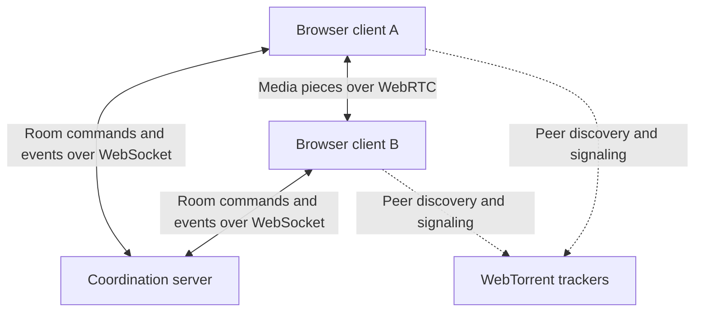
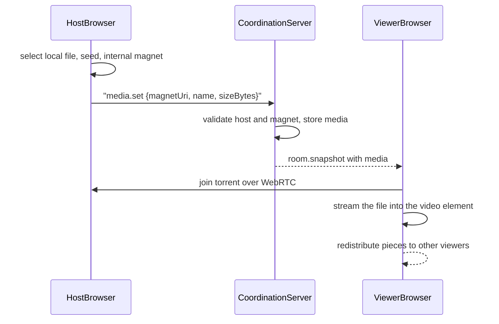

# SwarmCue Architecture

**Status:** Draft

## Purpose

SwarmCue is a browser-first, peer-to-peer watch-party application for small private rooms.

SwarmCue lets someone select a local video and watch it with friends. The file is progressively distributed directly between room participants while a coordination server keeps playback synchronized.

It is neither conventional server-side video streaming nor a general torrent application. It combines private peer-to-peer media distribution with synchronized watch-party coordination.

The system separates two main responsibilities:

1. **Media delivery:** WebTorrent and WebRTC deliver media directly between participants.
2. **Room coordination:** A central server manages participants, permissions, current media, and synchronized playback.

The coordination server does not upload, store, transcode, or stream the video itself.

## V1 Architectural Constraints

- The application is browser-first and supports media formats the browser can play natively.
- V1 accepts local, browser-compatible video files chosen by an authorized participant (the host).
- SwarmCue internally creates one browser-compatible torrent per selected file.
- The generated magnet URI is distributed to participants through the coordination server as room state.
- Arbitrary user-provided magnet links are not supported in V1.
- WebTorrent and magnet URIs are implementation details, not user-facing concepts.
- Rooms are temporary and anonymous; users do not need accounts.
- A room is designed and tested for up to five participants.
- Shared room state is stored in the coordination server's memory.
- V1 runs a single coordination server instance.
- Restarting the server may destroy active rooms.
- Media is transferred between peers rather than through the coordination server.
- WebTorrent handles torrent protocol behavior; SwarmCue does not implement BitTorrent itself.
- V1 does not include built-in text or voice chat.

## System Overview



Each participant runs the SwarmCue web client in their browser.
The browser clients maintain WebSocket connections to the coordination server for shared room state. Media pieces travel directly between participating peers through WebTorrent rather than passing through the coordination server.
WebTorrent-compatible trackers help peers discover and establish connections with each other. They do not act as the source of the media.

## Media Sharing Flow

1. The host selects a local video.
2. The host's browser creates and seeds a WebTorrent torrent for that file.
3. SwarmCue generates a browser-compatible magnet URI for the torrent.
4. The client sends the magnet URI and media metadata (name, size) to the coordination server.
5. The server checks that the sender is allowed to change the media, stores it as the current media, and distributes it to room participants.
6. Other clients automatically join the generated torrent and progressively play the video.
7. Participants redistribute downloaded pieces among themselves when possible.

The video file itself never passes through the coordination server. The server only stores and forwards the magnet URI and metadata.



## Browser Client Responsibilities

The browser client is responsible for:

- Rendering the room interface and participant state.
- Creating and maintaining the WebSocket connection to the coordination server.
- Sending user intentions such as play, pause, seek, and pause requests.
- Receiving authoritative room updates and applying them locally.
- Controlling the local HTML video player.
- Comparing local playback with the expected room position.
- Correcting playback drift when necessary.
- Reporting local readiness, buffering, and connection status.
- Creating and seeding a torrent from the host's selected local file.
- Joining the shared torrent, streaming it progressively, and redistributing downloaded pieces.
- Connecting progressively downloaded media to the video player.
- Managing personal subtitles and displaying shared subtitles.

## Coordination Server Responsibilities

The coordination server is responsible for:

- Creating temporary rooms and generating room identifiers.
- Tracking connected participants and their room membership.
- Maintaining authoritative shared room state.
- Managing host and controller permissions.
- Validating whether participants are allowed to perform requested actions.
- Managing the currently selected media (the internal magnet URI and its metadata; never the file itself).
- Accepting playback commands such as play, pause, and seek.
- Updating and broadcasting authoritative playback state.
- Managing buffering reports and pause requests.
- Sending complete room snapshots to joining or reconnecting participants.
- Handling disconnections and host reconnection grace periods.
- Transferring host ownership when the previous host does not return.
- Managing shared subtitle metadata.
- Removing abandoned or expired rooms.
- Rejecting malformed, unauthorized, or excessive client messages.

The coordination server does not download, upload, inspect, or stream media files.

## State Ownership

Shared room state is authoritative on the coordination server. A client may request a state change, but it cannot directly declare that the shared room state has changed.

| State                                 | Authoritative owner           |
| ------------------------------------- | ----------------------------- |
| Room membership                       | Coordination server           |
| Host and controller roles             | Coordination server           |
| Selected media                        | Coordination server           |
| Shared playback state                 | Coordination server           |
| Pending pause requests                | Coordination server           |
| Shared subtitle selection             | Coordination server           |
| Local playback position               | Browser client                |
| Local buffering and readiness         | Browser client                |
| Torrent progress and peer information | Browser client and WebTorrent |
| Personal subtitle selection           | Browser client                |
| Media bytes                           | Participating peers           |

Clients send commands that express intentions, such as requesting playback, pause, or seeking. The server validates these commands, updates its authoritative state, and broadcasts accepted changes.

When a participant joins or reconnects, the server sends a complete room snapshot rather than relying on the participant to reconstruct state from previous events.

A snapshot simply means a complete description of the room at that moment.

### Host role

The participant who creates a room is its host. Only the host may change the shared media; the server checks this against the sender's server-side session, not against anything the client claims.

- A host whose connection drops stays host for the reconnect grace period (see below). A short interruption never transfers host.
- When a host's grace period expires, host transfers to the earliest-joined participant who is currently connected, or, if nobody is connected, to the earliest-joined remaining participant.
- A host who leaves deliberately (`room.leave`) hands over host immediately by the same rule.
- The shared media is kept, which may leave it without a seeder (see Known Limitations).

Host authority and media availability are separate. Transferring host status changes who may control the room; it cannot restore pieces of the file that no remaining participant has.

### Reconnection and session resume

A dropped WebSocket does not remove a participant right away. The server holds their place for a grace period, and the browser reconnects and proves it owns the session.

- **Resume token.** On `room.create` or `room.join`, the server generates a secret resume token (32 random bytes, base64url) and sends it only to that participant in `room.joined`. The server keeps only a SHA-256 hash of it. Tokens never appear in snapshots, broadcasts, logs, or error messages. A participant ID is public and never authenticates anything.
- **Browser storage.** The client stores `{ v, roomId, resumeToken }` in `sessionStorage` (per tab), so a refresh in the same tab can resume. It is validated on read and cleared on deliberate leave, when the server rejects the session, when another tab takes it over, or when reconnecting gives up. It is kept when the server reports a newer protocol version, so reloading the page resumes.
- **Grace period: 30 s.** When a connection closes unexpectedly, the participant is marked `connected: false` in snapshots and keeps their seat (they still count toward the five-participant limit). If they resume in time, nothing else changes. Otherwise they are removed exactly once, with host transfer as described above. The room is deleted when nobody is left.
- **Deadlines live in the room domain; wake-ups live in the realtime layer.** The room store records each disconnected participant's `expiresAtMs` from its injected clock and decides expiry itself (`expireDue()`); it never schedules timers. The realtime layer schedules a wake-up at the deadline, and a stale or duplicate wake-up is harmless. A resume is accepted only while `now < expiresAtMs`, and expired participants are processed before a resume is evaluated, so a resume racing its deadline resolves deterministically.
- **Connections are versioned.** Each WebSocket gets a server-side connection ID, and every disconnect or leave names the connection it came from. Events from a connection that is no longer the participant's current one are ignored, so an old socket closing late can never disconnect or remove a participant whose new socket is active.
- **Newest connection wins.** If a valid resume arrives while the participant still has a connection (a half-open socket, or a duplicated tab that copied `sessionStorage`), the new connection takes over. The old one receives `session_replaced`, is closed with code 4000, and does not reconnect.
- **No token rotation in V1.** The token stays valid for the participant's lifetime. Rotation would make a leaked token single-use, but a resume response lost on a flaky connection would then lock the user out. The token only travels over the room's WebSocket and lives in one tab, where an attacker able to read it could act as the user directly anyway.
- **Heartbeat.** The server pings every connection every 15 s and terminates one that has not answered the previous ping, which starts its grace period. This catches connections that disappear without a close (sleeping laptops, dropped Wi-Fi).
- **Client reconnection.** After an unexpected close the client keeps showing the room ("Reconnecting…") and retries `room.resume` with capped exponential backoff: 500 ms doubling up to 5 s, with equal jitter (each delay is between half and all of that value). The browser's `online` event retries immediately. The client gives up after 60 s. Server rejections end the session with a message: an expired or unknown session (`resume_rejected`), a takeover by another tab (`session_replaced`), or a protocol mismatch (`unsupported_version`, which asks the user to reload).
- **Resynchronizing.** A successful resume (`room.resumed`) delivers a fresh snapshot. The client starts a new clock-estimation session and re-applies the room's playback timeline even if its revision did not change. The torrent is not reloaded when the shared media is unchanged.
- **Server restart.** Rooms live in memory, so after a restart every resume is rejected and clients return to the entry screen.

## Playback Synchronization Model

The coordination server maintains an authoritative playback state containing conceptually:

- The selected media.
- Whether playback is playing or paused.
- The media position at the time of the latest accepted update.
- The server time associated with that update.
- A revision or sequence number.

While the room is playing, clients calculate the expected room position from the stored media position and the time elapsed since the authoritative update.

expected position =
position at last update + elapsed time since that update

While the room is paused, the expected position remains fixed.
Clients compare the expected room position with their local video position. Small differences may be ignored, while larger differences require correction. Exact drift thresholds and correction methods will be determined through testing.
Playback commands are processed by the server before becoming shared room state. This prevents multiple clients from independently deciding the room's playback position.

This model means the server does **not** need to broadcast a timestamp every second. Clients can calculate where playback should currently be.

### Clock estimation

The server's `Date.now()` is the authoritative, transferable clock. Each client estimates it locally so it can later interpret server timestamps; the estimate never changes room state.

- Browser JavaScript cannot use native WebSocket ping/pong frames, so clients send an application message `clock.ping { protocolVersion, id }`. The server replies immediately with `clock.pong { id, serverTimeMs }`, where `serverTimeMs` is its own clock. The server never trusts or echoes a client timestamp. Pings are allowed before and after joining a room.
- For each sample, the client measures the round trip with `performance.now()`, assumes the server replied halfway through it, and stores the offset between its monotonic clock and server time: `offset = serverTimeMs - (sentAt + roundTrip / 2)`. Estimated server time is `performance.now() + offset`. Anchoring to the monotonic clock means client wall-clock changes (manual edits, resync after sleep) cannot corrupt the estimate.
- A measurement round sends 5 pings, one at a time, with a 2 s timeout each. The sample with the lowest round trip wins, because it has the least room for asymmetric-delay error (at most half the round trip). Unknown, duplicate, and late pongs are ignored. A round without valid samples keeps the previous estimate.
- Clients re-measure every 45 s and when the tab becomes visible again. Each WebSocket connection starts a fresh estimate; after a reconnect, the previous connection's estimate is used until the new one has measured. Clock failures are logged and never disconnect the room.

### V1 position sync

The room's playback state is `{ status, positionSeconds, updatedAtServerMs, revision }`. The pure math lives in `packages/playback-sync` and is shared by the server and the client.

- **Commands.** `playback.set { status, positionSeconds }` covers play, pause, and seek: the sender reports its own current position, and a seek is the current status with a new position. The server timestamps each accepted command with its own clock and increments the revision. A request that matches the current timeline (same status, position within 0.25 s of the expected position) is accepted but not re-broadcast, so clients echoing state they just applied cannot cause loops.
- **Applying room state.** On each new revision, and when a new video element loads its metadata, a client seeks to the expected position if it is more than 0.25 s off, then plays or pauses. Late joiners therefore start where the room is.
- **Drift correction (seek only).** While the room is playing, each client checks its position every second and seeks to the expected position when it is more than 0.5 s off. Checks are skipped while seeking or buffering, and corrective seeks have a 3 s cooldown. Expected server time comes from clock estimation; until the first estimate, a client uses its own clock.
- **Local actions.** A user's play, pause, and seek are reported as commands; events caused by applying room state are ignored. A change counts as the user's only when it follows a recent user gesture (`navigator.userActivation.isActive`), because browsers also pause and resume media on their own (for example, Chrome pauses muted playback that started without a gesture when it is offscreen). Browser-initiated pauses stay local, and a browser-initiated resume while the room is paused is reverted. Reaching the end of the media always pauses the room. Pressing play while the room is already playing (for example after the browser blocked autoplay) rejoins the room's position instead of restarting it.

### Personal subtitles

A participant can add a local `.srt` or `.vtt` file to the video they are watching. It stays in their browser: nothing is sent to the server or other participants, and it never changes room playback.

- **Validation.** The file extension decides the format (MIME types are unreliable for local subtitles). Files over 1 MiB are rejected before being read; typical feature-length subtitles are 50–250 KB. Text must be UTF-8, because browsers cannot reliably detect legacy encodings.
- **Normalization.** A pure module converts SRT to WebVTT (optional cue numbers, comma or dot milliseconds, any hour count, multiline text; malformed blocks are skipped and counted) and keeps WebVTT as written apart from the BOM and line endings. Text starting with a `WEBVTT` header is treated as WebVTT whatever its extension. SRT `<i>`, `<b>`, `<u>` are kept; `<font>` and `{\an8}`-style overrides are dropped, so their colors and positions are not supported.
- **Rendering.** The normalized WebVTT becomes a `Blob` object URL attached as a native `<track kind="subtitles">`, so the browser keeps cues on the media timeline through seeks, drift corrections, and resyncs, and shows them in native fullscreen. SwarmCue has its own compact control (add, show/hide, replace, remove); the browser's captions menu stays in step with it. Styling is limited to `::cue`, and OS caption preferences may override it.
- **Lifecycle.** A subtitle belongs to what the player shows: a picked local file, or a stream identified by its torrent. It is removed (and its object URL revoked) when the room's media changes, the host picks another file, or the participant leaves or enters another room. A reconnect keeps it. Subtitles are not stored, so a refresh loses them.

ASS/SSA files and shared (room-wide) subtitles are not part of this. Shared subtitles should reuse the normalized WebVTT and the same rendering path, travel in their own message rather than in room snapshots, and leave each participant free to show or hide them.

### Playback control (V1)

- Any participant may play, pause, or seek. The server applies commands in arrival order, so the last command wins.
- Host-only playback control may later become a room setting; controller roles come after V1.
- New media always resets playback to paused at position 0.

## Server and Deployment Structure

V1 uses one Node.js coordination-server process.

HTTP and WebSocket responsibilities may run in the same process, but they remain separated internally:

```text
Coordination server
├── HTTP interface
│   └── Health checks and future HTTP endpoints
└── Realtime interface
    ├── WebSocket connections
    ├── Room management
    ├── Command validation
    └── State broadcasting
```

The React application may be deployed as static files separately from the coordination server.
Running a physically separate WebSocket service is not required for V1. Separating the realtime code internally preserves the option to extract it into another service later if scaling requirements justify the additional complexity.
Room state is stored in the coordination server's process memory. Therefore:

- Restarting the server destroys active rooms.
- V1 does not require a database or Redis.
- Horizontal scaling across multiple coordination-server instances is not supported initially.

## Technology Stack

### Web client

- React
- TypeScript
- Vite
- Native HTML video element
- WebTorrent for peer-to-peer media delivery
- WebRTC indirectly through WebTorrent
- WebSocket communication with the coordination server

### Coordination server

- Node.js
- TypeScript
- Express for HTTP routes
- `ws` for WebSocket-based realtime communication, attached to the same HTTP server as Express
- In-memory room storage for V1

### Shared code

Shared TypeScript packages may contain:

- Client-server protocol types.
- Runtime message schemas (Zod).
- Pure playback synchronization logic.

Vitest is the test runner. Specific remaining library choices (for example WebTorrent trackers) will be selected when their requirements become clear.

## Known Limitations

- Active rooms are lost when the coordination server restarts.
- V1 cannot distribute rooms across multiple server instances.
- Playback is limited to formats and codecs supported by the participant's browser.
- Shared media stays available only while participants who hold the needed pieces remain connected. If the original host leaves before others have downloaded the file, playback may stall.
- Host transfer does not guarantee continued media availability.
- A host who refreshes the page keeps host authority but stops seeding: the selected file cannot survive a reload. Until they pick it again, their own player streams the media from other participants, so only pieces someone already downloaded are available. The tab remembers which media it shared (`sessionStorage`), and a banner asks the host to choose the same file again. Picking the same file (same torrent info hash) resumes seeding without restarting playback; a file that does not match is only shared after the host confirms it as new media, which restarts playback.
- Closing a tab is indistinguishable from a refresh, so it does not leave the room: the participant (and host role) is held for the 30 s grace period. Only the Leave button leaves immediately, and only while connected.
- Disconnected participants keep their seat during the grace period, so a full room stays full until they return or expire.
- There is no room-wide pause for buffering yet. A participant who is still downloading falls behind and is pulled forward by corrective seeks, which may cause repeated short stalls on slow connections.
- Drift correction uses seeks only, so a correction is a visible jump rather than a gradual catch-up.
- Peer discovery depends on available WebTorrent-compatible trackers.
- Browsers cannot connect to ordinary BitTorrent swarms (TCP/UDP peers, `udp://` trackers), so public torrents are not supported.
- SwarmCue does not provide server-side transcoding or media fallback.
- Personal subtitles are lost on refresh, must be UTF-8, and are cleared if a host who refreshed re-picks their file (the player switches from the stream to the local file).

## Out of Scope for V1

- Arbitrary user-provided magnet links.
- Public torrent swarms.
- A media queue; a room has one current media item.
- ASS/SSA subtitles; V1 subtitles are `.srt` and `.vtt`.
- A desktop or native companion application that bridges conventional TCP/UDP BitTorrent swarms to browser WebRTC peers.
- Acting as a general browser torrent client.

## Deferred Decisions

The following decisions will be made during implementation and testing:

- Final synchronization drift thresholds. The current starting values (0.25 s when applying room state, 0.5 s drift with a 3 s cooldown) should be tuned through testing.
- Whether minor drift should use temporary playback-rate adjustment instead of seeking (V1 currently seeks only).
- Final reconnection timings. The starting values (30 s grace, 15 s heartbeat, 500 ms to 5 s backoff, 60 s client give-up) should be tuned through testing.
- Room expiration duration.
- Shared subtitle distribution method.
- WebTorrent tracker selection and fallback behavior.
